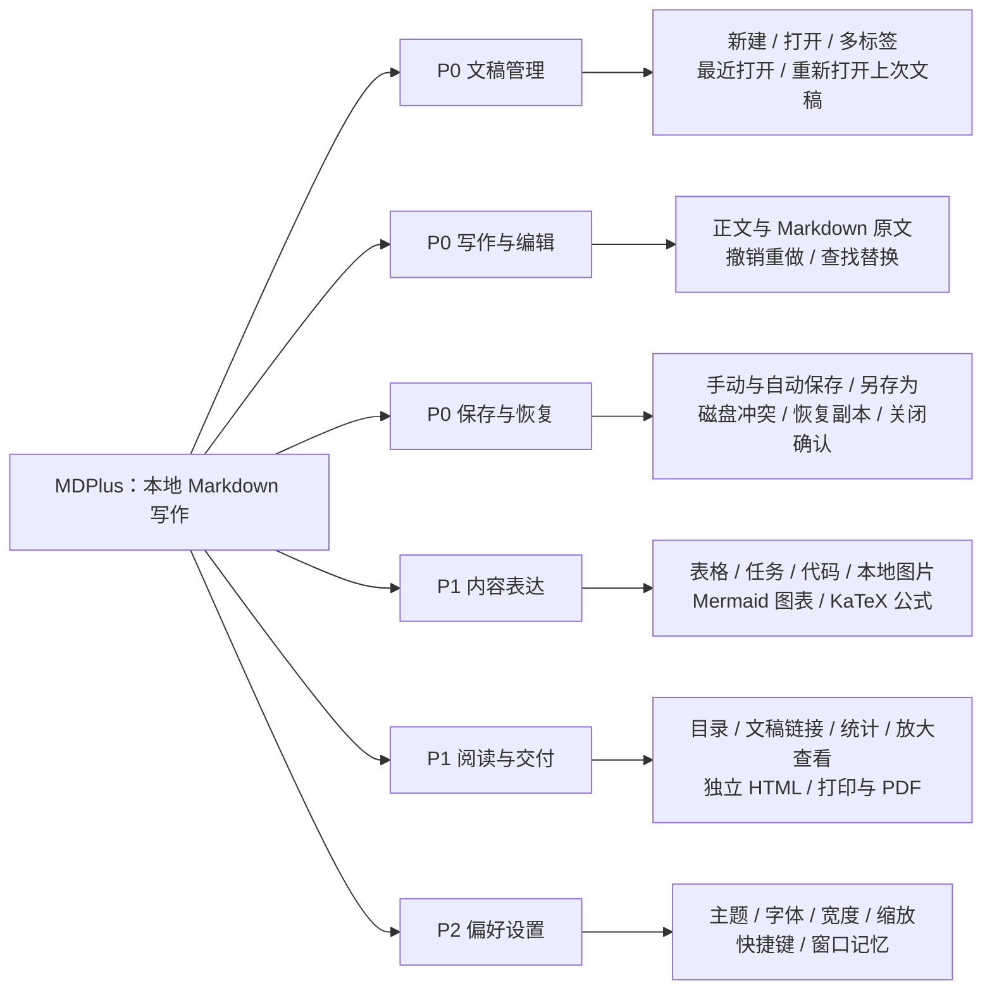
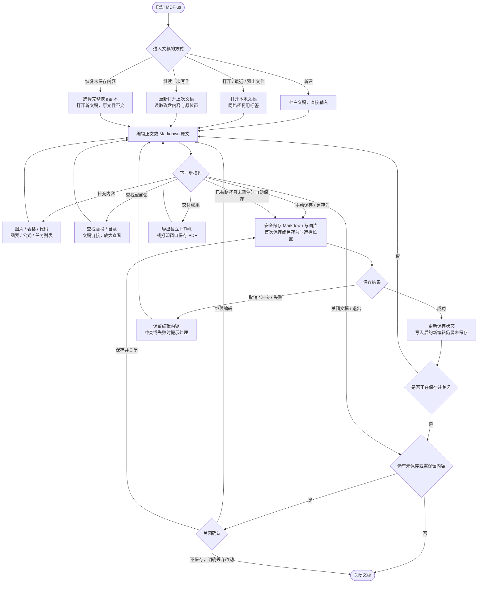

# MDPlus 核心功能架构与需求收束

整理日期：2026-11-19。依据当前本地 README、编辑工作流和实现梳理；产品定位与优先级为建议，尚未经过用户访谈验证。README 标注公开下载版本为 v0.2.5，本地 v0.2.6 候选版的功能需与已发布能力区分。

## 1. 产品定位与核心需求

**定位建议：面向个人用户的 Windows 本地 Markdown 编辑器，让用户快速开始写作、看懂内容、安全保存，并方便继续编辑和交付。**

核心用户任务收束为五项：

1. 快速开始：新建空白文稿、打开已有文件、继续上次写作。
2. 顺畅写作：在正文与 Markdown 原文之间切换，完成编辑、撤销、查找替换。
3. 清楚表达：使用图片、表格、代码、图表和公式组织内容。
4. 安全保全：知道内容是否保存；发生冲突、读写失败或异常退出时有明确处理入口。
5. 方便交付：保留通用 Markdown 文件，或导出独立 HTML、通过打印窗口保存 PDF。

主线为：**进入文稿 → 编辑内容 → 安全保存 → 继续写作或交付。**

## 2. 核心功能架构

以下按用户任务组织功能。P0、P1、P2 表示后续投入顺序；现有各层功能继续保留。

| 功能模块   | 用户目标                   | 收束后保留的功能                                                                              | 优先级 |
| ---------- | -------------------------- | --------------------------------------------------------------------------------------------- | ------ |
| 文稿管理   | 找到并进入要写的文稿       | 一键新建、本地文件打开、多标签、最近打开、双击文件与单实例复用、重新打开上次文稿              | P0     |
| 写作与编辑 | 连续完成正文编辑           | 正文 / Markdown 原文切换、基本 Markdown 编辑、撤销重做、当前文稿查找替换                      | P0     |
| 保存与恢复 | 保住最新内容并理解保存状态 | 首次保存、手动保存、另存为、自动保存、磁盘冲突处理、恢复副本、关闭确认                        | P0     |
| 内容表达   | 写清楚图文与技术内容       | 表格、任务列表、代码高亮、本地图片粘贴 / 拖入 / 选择、Mermaid 图表、KaTeX 公式                | P1     |
| 阅读与交付 | 定位内容并交付成果         | 目录、相对文稿链接、词数 / 字符数 / 行数、图片与图表放大查看、独立 HTML 导出、打印 / 保存 PDF | P1     |
| 偏好设置   | 适应个人写作习惯           | 浅深主题、界面 / 正文 / Markdown 与代码字体、正文宽度、编辑器缩放、自定义快捷键、窗口状态记忆 | P2     |

路径、格式与容量校验，清晰的错误反馈，以及键盘、焦点、输入法和减少动态效果支持，是所有模块共同的验收要求。

## 3. 需求收束决策

### 本轮重点

2026-11-20 已完成 P0 自动化核验；现有能力、核验结果与待完成的原生验收见 [P0 核心流程核验](ops/p0-verification-2026-11-20.md)。

- **P0：收尾主流程与数据保全。** 统一新建、打开、编辑、保存和关闭的操作；优先处理丢内容、误覆盖、状态误报和恢复失败。
- **P1：完成已有表达与交付能力的闭环。** 图片保存后可随文稿携带，图表与公式可正确查看和输出，目录与文稿链接帮助定位内容。
- **P2：维护已有偏好设置。** 调整保持易懂、可访问、可持久化；核心写作不依赖用户先完成配置。

### 入口安排

| 入口         | 承载功能                                                         |
| ------------ | ---------------------------------------------------------------- |
| 欢迎页       | 新建、打开、最近文稿；示例作为辅助入口                           |
| 主工具栏     | 新建、打开、保存、图片插入、正文 / Markdown 原文切换、查找、目录 |
| 标签栏       | 多文稿切换、关闭、新建                                           |
| 「更多」     | 另存为、HTML 导出、打印 / 保存 PDF、打开示例                     |
| 状态栏       | 保存与恢复状态、统计、缩放、排版与主题入口                       |
| 「最近打开」 | 文稿列表、启动时打开上次文稿的开关、失败文稿重试                 |

这些入口沿用当前产品结构，不增加一级导航。新建直接进入空白文稿，示例不成为写作前置步骤。

### 当前范围外

本轮不安排账户体系、云同步、多人协作、AI 写作、知识库 / 双向链接、插件市场、模板库或其他操作系统支持。这些属于后续独立需求，需要新的用户证据与投入评估。

## 4. 必须保留的产品规则

| 场景                     | 产品规则                                                                                                                                              |
| ------------------------ | ----------------------------------------------------------------------------------------------------------------------------------------------------- |
| 正文与 Markdown 原文切换 | 保留当前正文内容，合理保持编辑 / 阅读位置；需要直接处理语法、图表和公式原文时进入 Markdown 模式                                                       |
| 首次保存与自动保存       | 未命名文稿由用户选择位置后正式保存；已确定路径且自动保存未暂停的文稿才自动写盘                                                                        |
| 另存为                   | 选择新位置，处理图片相对引用；已有目标须确认替换，不能把两个已打开标签绑定到同一文件                                                                  |
| 保存中的新编辑           | 已写入内容与之后的新编辑分别判断，不能把尚未落盘的新内容显示为已保存                                                                                  |
| 磁盘外部变更             | 不静默覆盖。暂停自动保存并保留本地内容；根据当前状态允许确认重载、手动确认覆盖或另存为                                                                |
| 取消或保存失败           | 保留编辑内容，不宣布保存成功；冲突 / 读写失败明确反馈并提供重试或另存为的处理方向                                                                     |
| 图片插入与保存           | 当前接收本地 PNG / JPG / JPEG，不主动读取网络图片。新图片先暂存，保存时写入文稿同级 `assets/`，来源文件保留                                           |
| 文稿携带                 | 使用相对图片引用的文稿需要连同对应 `assets/` 一起携带；恢复副本不能替代正式保存                                                                       |
| 重新打开上次文稿         | `session` 保存已保存文稿的列表、顺序、活动文稿与位置；重新读取磁盘当前内容。失败记录保留并允许重试                                                    |
| 恢复未保存内容           | `recovery snapshot` 是独立的恢复副本；恢复为新的未保存文稿，不覆盖原文件。当前副本在本机保留 7 天，包含文字与图片，未加密；损坏副本不能当作可恢复内容 |
| 关闭文稿或退出           | 有未保存或需保留内容时，提供「保存并关闭 / 不保存 / 继续编辑」。保存取消、失败或仍有新编辑时不能关闭；明确选择不保存后，对应改动不自动恢复            |
| HTML 与 PDF              | HTML 是包含本地资源的独立输出；PDF 通过系统打印窗口生成。输出当前编辑内容不要求先保存原文稿，也不代表原文稿已经保存                                   |
| 文稿链接                 | 当前正文支持相对 `.md` / `.markdown` 文稿链接，同路径复用标签；源码链接导航与跨文稿标题定位不纳入本轮                                                 |

## 5. Mermaid 功能流程图

以下按一份文稿展开；退出应用时，对仍需保留内容的文稿逐份执行关闭确认。保存节点合并路径选择、外部变更校验和图片迁移，具体规则见上一节。

恢复副本随需要保全的内容更新，与正式保存分开判断。打开、重开、恢复或导出失败时保留可用文稿或副本并反馈；这些异常路径在图中合并省略，不能在实现与验收中省略。

## 6. 核心验收场景

| 场景               | 验收结果                                                                                   |
| ------------------ | ------------------------------------------------------------------------------------------ |
| 新用户开始写作     | 新建即能输入，首次保存可选择位置；取消保存后内容仍在                                       |
| 连续编辑           | 双模式切换、撤销重做、查找替换和标签切换保留内容，输入法组字不误触全局操作                 |
| 图文保存           | 图片与正文保存后重新打开可用；另存为后的引用正确，来源图片不被删除                         |
| 外部冲突或保存失败 | 不静默覆盖，不误报已保存；保留本地内容并明确告知如何继续处理，恢复副本写入失败单独显示     |
| 继续写作与异常恢复 | 正常重开按 `session` 读取磁盘文稿与位置；未保存内容从独立 `recovery snapshot` 恢复为新文稿 |
| 交付与退出         | HTML 本地资源完整；PDF 在 Windows 打印窗口实际验收；有改动的关闭、取消和丢弃行为与提示一致 |

这些是验收要求，不代表本次已执行应用验收。发布前仍需完成 Windows 安装版的输入法、DPI、系统打印及安装 / 升级 / 卸载保留数据检查。

## 7. 依据与变更范围

- [README](../README.md)：产品定位、已有能力及候选版边界。
- [编辑工作流](editor-workflows-2026-11-07.md)：新建、查找替换、继续写作、图片与文稿导航。
- [标签状态模型](state-model.md)与[术语表](../GLOSSARY.md)：正式保存、`session`、`recovery snapshot` 的区别。
- [IPC 契约](ipc.md)：文件、图片、导出与恢复的验证和失败边界。
- [当前体验优化记录](history/ui-ux-2026-11-19.md)：入口安排与尚未完成的原生验收。
- 当前实现：[App](../src/App.tsx)、[文稿管理](../src/hooks/useDocumentFiles.ts)、[保存](../src/hooks/useDocumentSave.ts)、[关闭](../src/hooks/useDocumentClose.ts)、[恢复](../src/hooks/useRecovery.ts)、[导出](../src/hooks/useDocumentExport.ts)。
- [GitHub Issue #2](https://github.com/xsuooo/MDplus/issues/2)：2026-11-19 查询开放 Issues 时仅有依赖维护任务；本次不从中扩展产品功能范围。

本次仅新增此产品文档。调用方、测试、fixture、配置、导出接口和现有数据格式无需调整；不创建或修改 GitHub Issues。
